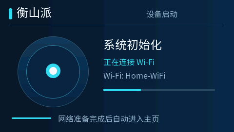
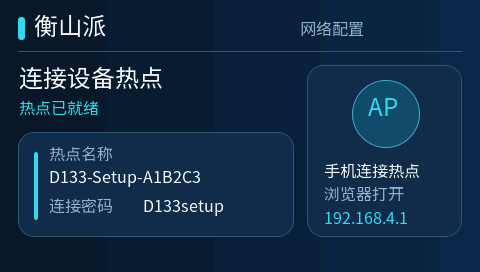
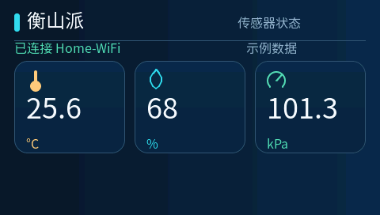
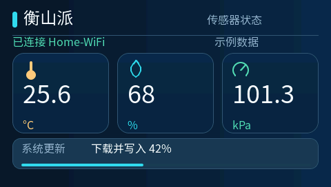
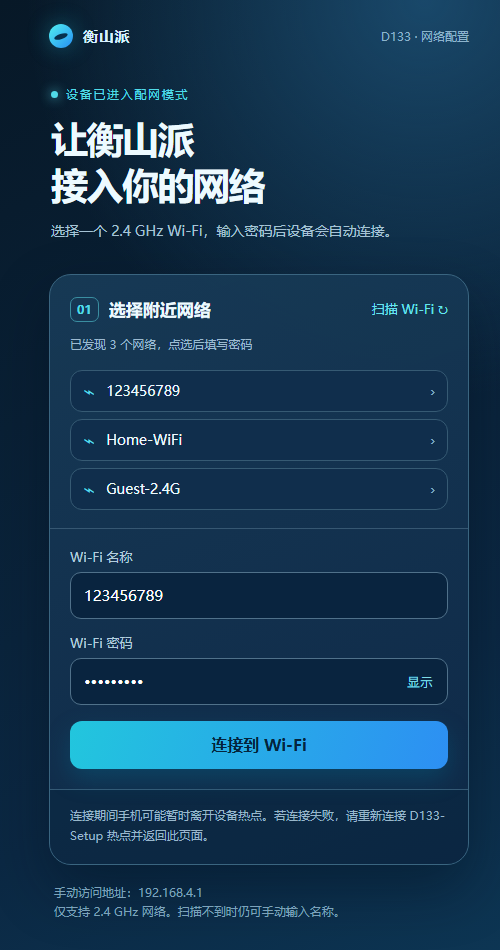
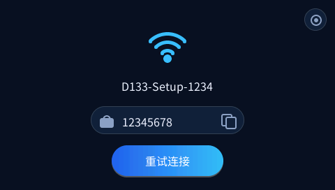
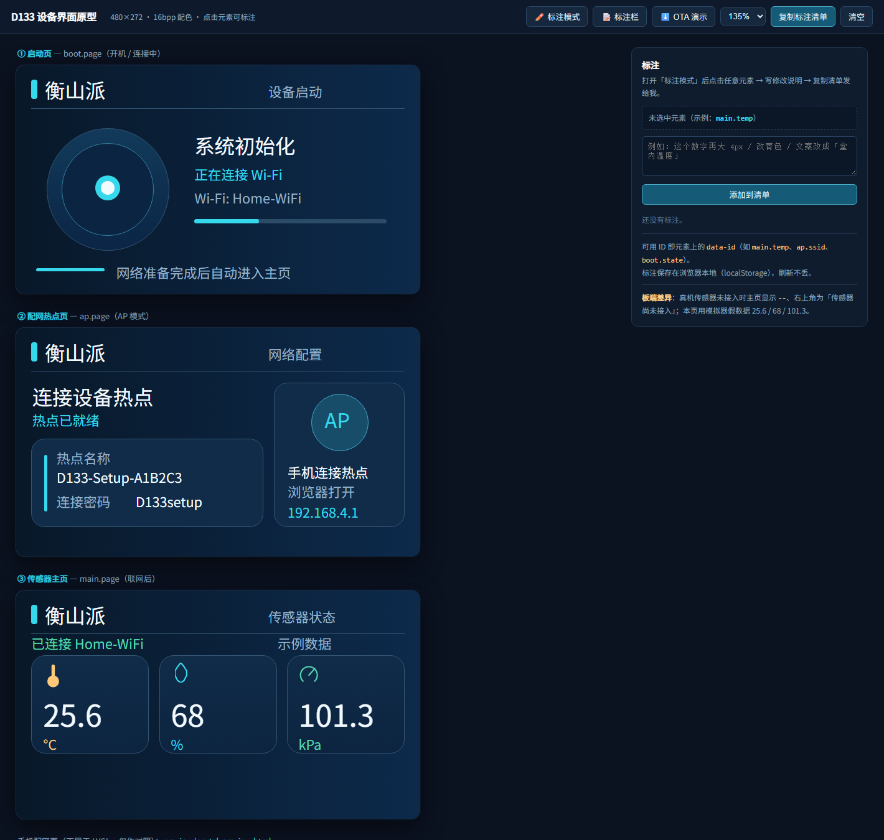

# D133 联网小屏：AP 配网 + OS A/B OTA + LVGL 界面

衡山派 **D133EBS**（ArtInChip D13x，RISC-V，16 MiB NOR / 8 MiB PSRAM，480×272 RGB565 + GT911 触摸，RTL8189 SDIO Wi-Fi）上的一个完整小产品原型：

1. 开机自动连接已保存的 Wi-Fi，失败时开 **手机热点配网页**（`http://192.168.4.1/`），保存凭据后联网；
2. 三页 LVGL 9.1 界面（启动 / 配网 / 传感器主页）：传感器用图标+大号读数展示，OTA 只在升级过程中于底部弹出进度条；
3. 局域网 **网页 OTA**（只升级 OS，A/B 双分区，CRC32 + CPIO + 回读校验）；
4. 电脑上可跑同一份界面的 **LVGL 桌面模拟器** 和无窗口截图；
5. 手机配网页的 **独立 HTML 预览**。

| 启动页 | 配网页 | 主页 | OTA 升级中 |
|---|---|---|---|
|  |  |  |  |

| 手机配网页（预览） | 早期设计稿（未落地） |
|---|---|
|  |  |

## 仓库内容

```
├─ firmware/                     # 衡山派固件项目（叠加到 luban-lite 上）
│  ├─ application/rt-thread/helloworld/netapp/   # 应用：联网/配网/OTA + 配网页 + LVGL 界面 + 字体
│  ├─ target/configs/            # netapp_defconfig
│  ├─ tools/netapp/              # build.ps1、OTA manifest、主机协议测试
│  ├─ patches/                   # 对 luban-lite 的 8 处源码改动（文本 patch）
│  └─ docs/netapp-design.md      # 配网/OTA 设计说明与安全边界
├─ simulator/                    # LVGL 桌面模拟器（源码 + 截图）
├─ preview/                      # 手机配网页的 HTML 预览与早期设计稿
├─ fonts_src/                    # Noto Sans SC 字体源（OFL）与子集脚本
├─ docs/                         # 构建、烧录、架构、界面调试说明
└─ setup.ps1                     # 克隆 SDK → 叠加本项目 → 可选编译
```

**本仓库不包含**：luban-lite SDK 本体（约 1.9 GB，厂商预编译库和工具链压缩包）、构建产物（`output/`、`build/`）、烧录与设计工具安装包。SDK 由 `setup.ps1` 从 gitee 拉取到固定 commit 后叠加本仓库内容，保证可复现。

## 快速开始

### 1. 编译固件

```powershell
git clone <this repo> d133-netapp
cd d133-netapp
.\setup.ps1                 # 克隆 luban-lite f5be1e4c + 应用 patch + 拷入项目文件
.\luban-lite\tools\netapp\build.ps1
```

产物在 `luban-lite\output\d13x_JLC_rt-thread_helloworld_netapp\images\`：

- `d13x_JLC_v1.1.0.img`：首次 USB 烧录的完整镜像
- `ota.cpio`：之后通过局域网 OTA 的升级包

详细步骤、依赖和常见问题见 **[docs/firmware-build.md](docs/firmware-build.md)**，烧录见 **[docs/flashing.md](docs/flashing.md)**。

### 2. 跑 LVGL 模拟器

```powershell
cd simulator
cmake -S . -B build -G Ninja -DCMAKE_BUILD_TYPE=Release '-DCMAKE_POLICY_VERSION_MINIMUM=3.5' -DDIRECTX=OFF
cmake --build build --parallel 4
.\build\d133_preview.exe --page main
```

需要 CMake / Ninja / MinGW-w64；LVGL 与 SDL 直接编译 SDK 里自带的源码。详见 **[simulator/README.md](simulator/README.md)**。

### 3. 看界面

设备三页（启动 / 配网 / 主页）有一个**可标注的 HTML 原型**：`preview/device-ui.html`。
用浏览器打开后开启「标注模式」，点任意元素即可写修改备注，复制清单就能直接提需求：

```powershell
start preview\device-ui.html
```



手机配网页：

```powershell
python preview\preview_portal.py        # 生成 preview\portal-preview.html
start preview\portal-preview.html       # 用独立浏览器/手机模式查看
```

可编辑的页面源码在 `firmware/application/rt-thread/helloworld/netapp/portal.html`，改完运行 `generate_portal.py` 重新生成固件内嵌的 `portal_html.h`。

## 硬件与系统

| 项 | 配置 |
|---|---|
| 主控 | ArtInChip D13x，RISC-V 32 位，CPU 480 MHz |
| 内存 | SRAM 1 MiB + PSRAM 8 MiB |
| 存储 | 16 MiB SPI NOR，分区 `256k spl / 128k env / 128k env_r / 3328k os / 3328k os_r / 8m rodata / 1m data` |
| 显示 | 480×272 RGB565（PRGB 16bit） |
| 触摸 | GT911（I2C2） |
| Wi-Fi | RTL8189 SDIO（PC.7 电源脚） |
| 系统 | RT-Thread 4.1.1 + LVGL 9.1 + lwIP 2.1.3 + LittleFS + FatFS |

## 已知限制（开发联调版）

- **OTA 安全**：HTTP 明文、口令即热点密码（默认 `D133setup`）、无签名/验签/防降级；仅限可信局域网。
- **无有效回滚**：bootloader 加载新 OS 后立即清 `upgrade_available`，`bootcount` 永远不会触发回退；「能启动但随后崩」只能 USB 重刷。
- **LVGL 线程栈**：port 里实际按 8 KB 建栈（Kconfig 的 32768 未被使用），且板端 LVGL 堆只有 64 KB；长跑前建议 `list_thread` 看水位。
- **模拟器色深**：已改为 16 bpp 与板端一致；即便如此，板端 RGB565 渐变仍会有轻微色带。
- **烧录**：命令行 `upgcmd image` 在可执行 fwc 重枚举后会报 `No device is connected`（工具重连缺陷），请用 AiBurn GUI 的 *Burn online*，详见 [docs/flashing.md](docs/flashing.md)。
- **资源占用**：当前镜像里 `rodata` 分区 91.9% 被 SDK demo 资源占满（界面并不读取），可从 defconfig 关闭以把镜像从 10.9 MB 降到约 3.2 MB。

## 许可与致谢

- 本项目自有代码：暂未指定开源许可证（如需开源请补充 LICENSE）。
- LVGL（MIT）、RT-Thread（Apache-2.0）、lwIP（BSD）、LittleFS（BSD）等由 luban-lite SDK 提供，遵循各自许可证。
- 中文字体：Noto Sans SC，SIL Open Font License 1.1，见 `firmware/application/rt-thread/helloworld/netapp/ui/OFL-NotoSansSC.txt`。
